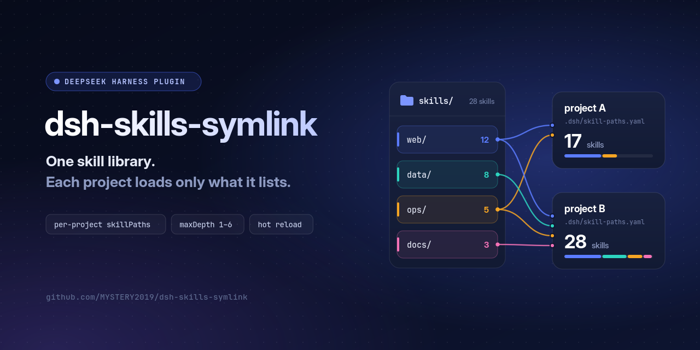
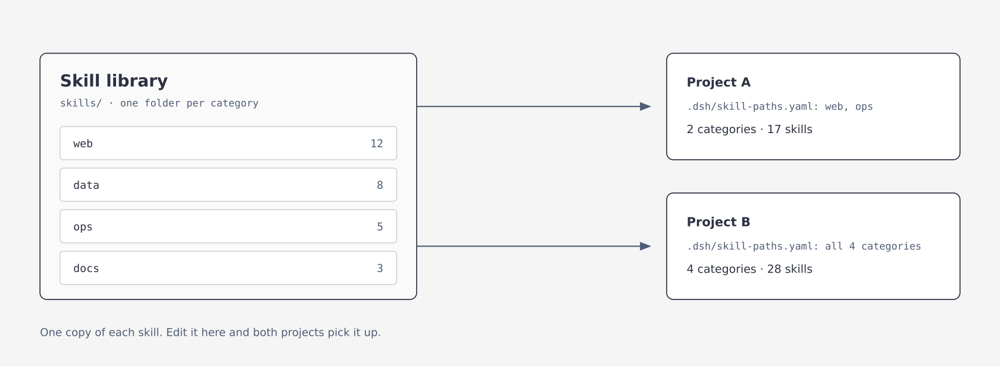
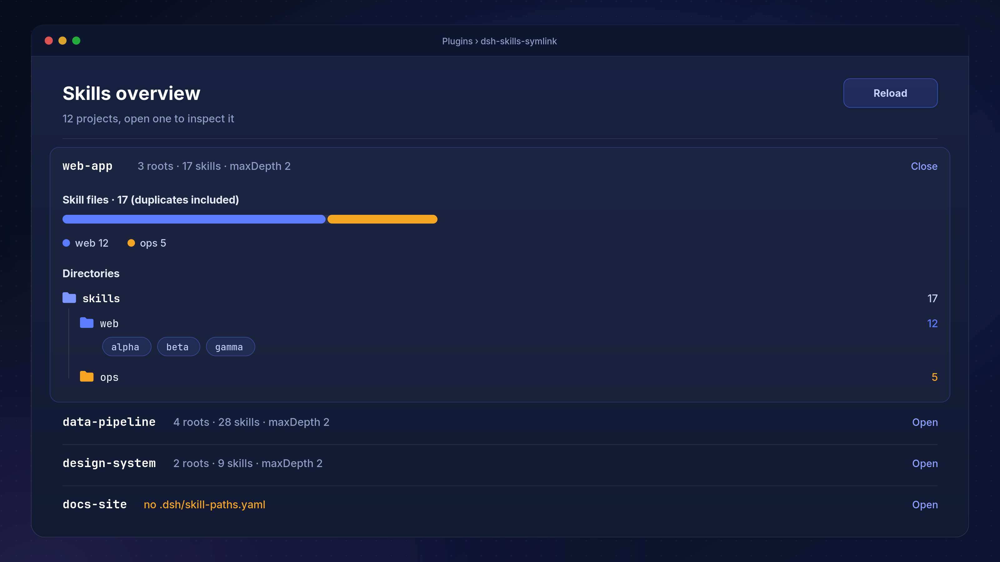

<p align="center">
  
</p>

<p align="center">
  <a href="https://github.com/MYSTERY2019/dsh-skills-symlink/releases"></a>
  <a href="LICENSE"></a>
  <a href="https://github.com/deepseek-ai/deepseek-harness"></a>
  =24">
</p>

<p align="center">
  <b>English</b> · <a href="README.zh.md">中文</a>
</p>

<p align="center">
  <a href="#-install">Install</a> ·
  <a href="#-use">Use</a> ·
  <a href="#-configuration">Configuration</a> ·
  <a href="#-troubleshooting">Troubleshooting</a>
</p>

Give every project in [DeepSeek Harness](https://github.com/deepseek-ai/deepseek-harness) (DSH) its own set of skills. It replaces the skill symlink from Hermes: one shared library, and each project loads only the categories it lists. The plugin creates no symbolic links; the name only borrows the Hermes term.

## ✨ Highlights

- 🗂️ **Per-project skill sets**: one `.dsh/skill-paths.yaml` per project, and each project sees only what it lists
- 📚 **One path for a categorised library**: `maxDepth` reads `category/skill/SKILL.md` layouts up to 6 levels deep
- 🔥 **Hot reload**: add or remove a skill without restarting DSH
- 🛡️ **Safe by default**: paths and symlinks outside the project are rejected, and the plugin makes no outbound requests
- 🩺 **Diagnostics built in**: a log of every root scanned, plus a post-install check script
- 🧭 **Visual overview**: see each project's skill mix on the Plugins page

## 🤔 Why

If you came from Hermes, you will miss its skill symlink. A skill lives once in a central repository, and any project that wants it symlinks it into its own skills directory. Edit the original and every project follows, with nothing to copy. Project A links the three writing skills, project B links the two tools skills, and each sees exactly its own set. Adding a skill is one more link; nothing else changes.

DSH replaced that with skill roots configured through `customSkillDirs`. Three things break on the way over.

First, each root only accepts `<root>/<skill>/SKILL.md`. A library laid out as `category/skill/SKILL.md` yields nothing when you point at the parent, with no error and no log line.

Second, the setting belongs to the host or the preset, not to the project. Every project sees the same skills, and "this project sees category A only" cannot be expressed.

Third, every skill's name and description goes into context each turn. With a large library that cost is fixed and cannot be scoped down.

This plugin moves the paths into the project, one `.dsh/skill-paths.yaml` per project, and `maxDepth` in the plugin row lets it read category folders, so a single parent path is enough. From one library, project A loads 17 skills and project B loads 28.

<p align="center">
  
  <br>
  <i>One library, two projects: A loads 17 skills, B loads 28.</i>
</p>

## 📦 Install

Requires DSH `>=0.2.1-rc.5 <0.3.0` (the 0.2.x line), Node.js `^22.19.0 || >=24.0.0`, and access to GitHub while installing.

**DSH Desktop:** open **Plugins** in the sidebar and add

```text
github:MYSTERY2019/dsh-skills-symlink#v0.4.0
```

Restart DSH afterwards; `dsh-skills-symlink` should appear on the Plugins page. The 0.2.x `dsh` CLI refuses `--profile desktop`, so Desktop installs from the Plugins page only.

**Other profiles (for example `web`) from the command line:**

```bash
dsh plugin --profile web add github:MYSTERY2019/dsh-skills-symlink#v0.4.0
```

You can also download `dsh-skills-symlink-0.4.0.tgz` from the Release and pass its path instead of the `github:...` spec.

> [!IMPORTANT]
> **Installed v0.4.0 before?** The `v0.4.0` tag was moved to the fixed commit on 2026-11-04. An existing install does not update itself: remove it and install again as above.

## 🚀 Use

Create `.dsh/skill-paths.yaml` in the project root:

```yaml
version: 1
skillPaths:
  - skills
  - tools/skills
```

The project now sees only the skills under those two directories. Other projects do not. Paths are relative to the project root (the nearest Git root, otherwise the session's working directory).

A shared library outside the project needs `allowExternalPaths` in the plugin row first (see Configuration). Without it, that entry is skipped and the log says why:

```yaml
# needs allowExternalPaths: true in the plugin row
version: 1
skillPaths:
  - ../shared-skills
```

The project file knows two keys, `version` and `skillPaths`. Options such as `maxDepth` and `ignore` belong to the plugin row; written into the project file they have no effect. The plugin ignores them, logs where they belong, and still loads the paths. An invalid entry (outside the project, not a string) is skipped on its own as well.

### One path for a categorised library

If the library is laid out as `category/skill/SKILL.md`, the project file still names the parent:

```yaml
version: 1
skillPaths:
  - skills
```

and `maxDepth` in the plugin row says how deep to go (see Configuration):

| Layout | `maxDepth` |
|---|--:|
| `root/skill/SKILL.md` | 1 (default) |
| `root/category/skill/SKILL.md` | 2 |
| `root/group/category/skill/SKILL.md` | 3 |

Valid values are 1 to 6. Anything else (`0`, `7`, `2.5`) is treated as 1, with a warning in the plugin log.

### When you add a skill later

| Where you put it | What happens | Work needed |
|---|---|---|
| Inside a category you already list, as `category/new-skill/SKILL.md` | picked up like its neighbours | none |
| As a new sub-category, `category/new-group/skill/SKILL.md` | promoted to its own root | none, if `maxDepth` already reaches that depth |
| As a new top-level category beside the ones you list | invisible, because the project file names categories one by one | add a line per project, or list the common parent instead |
| Deeper than `maxDepth` allows | invisible, and that root reports 0 skills | raise `maxDepth` in the plugin row |

Skills are read when a session starts, so a change appears in the next session rather than the one
that is running. `scripts/post-install-check.mjs` points at the depth case when a root resolves to
zero skills but holds `SKILL.md` files one level further down.

## ✅ Check that it took effect

After installing and restarting, run the check that ships with the package:

```bash
node ~/.dsh/profiles/desktop/node_modules/dsh-skills-symlink/scripts/post-install-check.mjs --project .
```

It prints the profile that holds the plugin, the version the host actually loaded, and every root
your project resolves. A version mismatch, a missing plugin row, or a project without a config
file is listed as a problem and the exit code becomes 1. Pass `--profile` to look at another
profile, or `--json` to script it.

## 🔧 Configuration

Override the plugin row in the profile's `cordis.patch.yml`:

```yaml
- id: dsh-skills-symlink
  config:
    maxDepth: 2
    allowExternalPaths: true
    ignore:
      - _archive
```

| Key | Default | Meaning |
|---|---|---|
| `maxDepth` | `1` | How many levels to scan, an integer from 1 to 6 |
| `ignore` | `[]` | Category or group folder names skipped while descending; `prefix*` is supported; case-insensitive on Windows |
| `maxRoots` | `2000` | Most roots one project may expand into. Configured roots always stay, the rest of the budget is shared fairly between them, and empty folders watched only for new skills do not count |
| `allowExternalPaths` | `false` | Allow absolute paths, `..`, and symbolic links that point outside the project |
| `watch` | `true` | Watch skill folders so adding or removing a skill needs no restart |
| `watchFollowSymlinks` | same as `allowExternalPaths` | Whether watching follows symbolic links |
| `configWatchIntervalMs` | `500` | How often `.dsh/skill-paths.yaml` is checked, 10–60000 ms |
| `diagnosticsFile` | `true` | Write the diagnostics log |
| `logFile` | `''` | Custom log path; a relative path is resolved from the profile directory; empty writes `<profile>/logs/dsh-skills-symlink.log` |

A number that is out of range or not an integer falls back to its default with a warning; it never stops DSH from starting.

> [!WARNING]
> When DSH overrides a plugin row it replaces `config` as a whole; it does not merge. Write every key you need in one block, or the rest falls back to defaults. A row with only `maxDepth`, for example, turns `allowExternalPaths` back to `false`, and paths outside the project are skipped (and logged).

## 🧭 See the current structure on the plugin page

Open **Plugins → dsh-skills-symlink** in the sidebar and scroll down to the plugin's own sections.

**Skills overview** lists one row per project. A row is read only when you open it, so the list opens fast.

<p align="center">
  
  <br>
  <i>Skills overview on the Plugins page: one row per project, expanded to its skill mix and folder tree.</i>
</p>

- The bar at the top is the project's skill total, split by category, with a legend matching colour, category name and count
- **Directories** are the roots after `maxDepth` expansion, not the lines in your yaml
- Click any directory row to list the skills under it
- When names collide, the summary adds "(N duplicates)"; which copy wins is described under "Which skill wins on a name clash"

The text follows the browser language: Chinese for a Chinese locale, English otherwise.

This section is read-only. To change configuration, go to **Settings → Plugins**, where a **Skill structure** tab reads one project at a time. It lists the configured paths, the expanded roots, and a **Watched only** line for empty categories watched so a first skill is found. It can add and remove paths in `.dsh/skill-paths.yaml`: the new file is validated before it is saved, and on an error the old file stays as it was.

The settings card reads and writes only workspaces DSH has opened. Its endpoint sits under DSH's own `/api` and passes the host's sign-in and Host/Origin checks first.

## 🩺 Troubleshooting

The first time skills are listed in a project, the plugin writes a block to `<profile>/logs/dsh-skills-symlink.log`:

```text
roots() first call for cwd=.../my-app: projectRoot=.../my-app, configFile=found,
  configuredRoots=2, roots=3, watchOnlyRoots=1, maxDepth=2
  root[0] .../my-app/skills/web
  root[1] .../my-app/skills/data
  root[2] .../my-app/skills/data/api
```

Each `root[i]` is a folder this project actually scanned. When a skill is missing, start from this list.

Common causes: `maxDepth` too small, the folder matched by `ignore`, a path outside the project (or a symbolic link pointing outside it) without `allowExternalPaths`, or plugin options written into the project file. The last three each leave a warning in the log.

A successful load writes an `applied` line. `no project config at ...` means the project has no config file.

## 🏆 Which skill wins on a name clash

The lower rank wins:

| Source | rank |
|---|--:|
| `<project>/.dsh/skills` | 100 |
| `<project>/.agents/skills` | 200 |
| Roots configured by this plugin | 250 |
| Global `customSkillDirs` | 300 |
| User-level folders | 400 / 500 |

Between this plugin's own roots, the order is depth (shallower first), then `skillPaths` order, then code-point order of folder names (`B` sorts before `a`).

Every shadowed copy is logged with the `SKILL.md` paths of both sides, at `maxDepth: 1` too, and again when the set of clashes changes.

## 🔒 Security

The plugin reads files only while DSH resolves skills, and writes only the selected workspace's `.dsh/skill-paths.yaml` when you save the settings card. It makes no outbound requests and reads no credentials.

- Absolute paths and `..` are rejected by default. Whether a path is inside the project is decided by its real path, so a symbolic link inside the project that points outside is rejected too, and checked again when a skill's body is loaded. Cloning someone else's repository cannot make DSH read other files on your machine.
- Writes go only to workspaces DSH knows, are refused when the `.dsh` folder or the config file is a symbolic link, and go through a temporary file and a rename, so a half-written file is never left behind.
- A write request must be same-origin, `application/json`, and at most 16 KB.

## 🔀 Differences from upstream

This repository is a fork of [NeoRrrr/dsh-project-skill-paths](https://github.com/NeoRrrr/dsh-project-skill-paths) v0.3.0.

| | upstream v0.3.0 | here v0.4.0 |
|---|:--:|:--:|
| Per-project `skillPaths` | ✅ | ✅ |
| Settings card | ✅ | ✅ |
| Hot reload | ✅ | ✅ |
| Multi-level scan `maxDepth` | ❌ | ✅ |
| `ignore` / `maxRoots` | ❌ | ✅ |
| Fake-skill guard | ❌ | ✅ |
| Loads on DSH 0.2.x | ❌ | ✅ |
| Diagnostics log | ❌ | ✅ |

The repository, the package name and the plugin id are all `dsh-skills-symlink`; that id is what the Plugins page shows. It does the same job as `dsh-project-skill-paths`; do not install both.

<details>
<summary>Expansion rules (edge cases)</summary>

- **Descending and promoting are separate.** Every folder down to depth `maxDepth − 1` is visited, but only a folder whose direct children include a skill folder becomes a root. Pure grouping folders are walked through, so `maxDepth: 3` works for a grouped layout.
- **Expanded roots only count folder skills.** In a promoted category, top-level `.md` files are documentation and are dropped, so they never become fake skills. Flat `.md` skills placed directly in a configured root still work as upstream.
- **A folder holding only flat `.md` files is not promoted.** Put each skill in `<skill>/SKILL.md`, or add that folder itself to `skillPaths`.
- **No duplicates.** A folder with its own `SKILL.md` is a skill: it is never promoted and never descended into. Folders are de-duplicated by real path, so a symlinked alias adds nothing.
- **Hot reload.** With `watch: true` (the default) and `maxDepth ≥ 2`, empty category and group folders are watched too, so the first skill dropped in is found. These are the **Watched only** folders on the settings card; they do not count toward `maxRoots`.
- **One unreadable root only drops itself.** The skipped root is logged and the others load. A folder that cannot be read during expansion is reported once with its path; a missing folder is not reported.
- **`templates/` counts as a category.** With `maxDepth ≥ 3`, a template folder holding a sample `SKILL.md` is discovered too; if it is only scaffolding, add it to `ignore`.
- **`maxDepth: 1` matches upstream exactly:** only the configured roots are scanned, one level deep.

</details>

## 🧑‍💻 Development

```bash
npm ci
npm run check      # syntax check + all tests
npm pack --dry-run
```

## 🧹 Uninstall

On Desktop, remove it from the **Plugins** page. For other profiles:

```bash
dsh plugin --profile web remove dsh-skills-symlink
```

## 📄 License

[MIT](LICENSE)
