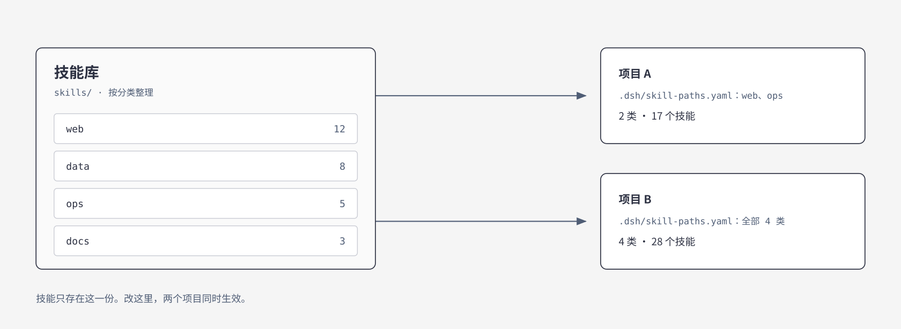

语言：[English](README.md) | **中文**

# dsh-skills-symlink

给 [DeepSeek Harness](https://github.com/deepseek-ai/deepseek-harness)（DSH）的每个项目配一套自己的技能。它替代 Hermes 里的 skill symlink：一份共享技能库，每个项目只加载自己列出的分类。插件本身不创建任何符号链接，名字只是借用 Hermes 的说法。

## 为什么需要它

如果你是从 Hermes 过来的，会想念它的 skill symlink。技能只有一份，放在中央仓库；哪个项目要用，就往自己的技能目录里链几个过去。改原件，所有项目跟着变，不用复制。A 项目链写作那几个，B 项目链工具那两个，各自看到的正好是自己要的。加技能就是多链一条，不动别的项目。

DSH 换成了技能根，用 `customSkillDirs` 配。迁过来会撞上三件事。

第一，每个根只认 `<根>/<技能>/SKILL.md` 这一层。库要是按 `分类/技能/SKILL.md` 整理，把父目录配上去，一个技能都扫不到，不报错，日志里也没有。

第二，这一项挂在宿主或预设上，不挂在项目上。所有项目看到同一批技能，「这个项目只看 A 类」写不出来。

第三，技能的名称和描述每轮都进上下文。库一大，这笔开销固定，还缩不下去。

这个插件把路径挪进项目，每个项目一份 `.dsh/skill-paths.yaml`；插件行里的 `maxDepth` 让它直接吃分类目录，写一条父路径就够。同一份库，项目 A 只加载 17 个，项目 B 加载 28 个。



## 安装

需要 DSH `>=0.2.1-rc.5 <0.3.0`（0.2.x）、Node.js `^22.19.0 || >=24.0.0`，安装时要能访问 GitHub。

**DSH Desktop：** 打开侧边栏 **Plugins** 页面，添加

```text
github:MYSTERY2019/dsh-skills-symlink#v0.4.0
```

装完重启 DSH，Plugins 页面里应该能看到 `dsh-skills-symlink`。0.2.x 的命令行 `dsh` 会拒绝 `--profile desktop`，所以 Desktop 只能在 Plugins 页面装。

**其他 profile（例如 `web`）用命令行：**

```bash
dsh plugin --profile web add github:MYSTERY2019/dsh-skills-symlink#v0.4.0
```

也可以下载 Release 里的 `dsh-skills-symlink-0.4.0.tgz`，把上面的 `github:...` 换成这个文件的路径。

> **装过旧的 v0.4.0？** `v0.4.0` 这个 tag 在 2026-11-04 移到了修复后的提交上。已安装的副本不会自动更新，请先卸载再按上面的步骤重新安装。

## 使用

在项目根建 `.dsh/skill-paths.yaml`：

```yaml
version: 1
skillPaths:
  - skills
  - tools/skills
```

这个项目就只看到这两个目录下的技能，别的项目看不到。路径相对项目根（最近的 Git 根目录，没有就是会话的工作目录）。

项目外的共享库要先在插件行里打开 `allowExternalPaths`（见下面的「配置」），否则这一条会被跳过，并在日志里写明原因：

```yaml
# 需要插件行里的 allowExternalPaths: true
version: 1
skillPaths:
  - ../shared-skills
```

项目文件里只认 `version`、`skillPaths` 两个键。`maxDepth`、`ignore` 这类选项属于插件行，写进项目文件不会生效：插件会忽略它们，在日志里提示应该写到哪里，其余路径照常加载。某一条路径不合法（越界、不是字符串）时也只跳过那一条。

### 分类目录只写一条路径

库按 `分类/技能/SKILL.md` 整理时，项目文件照常写父目录：

```yaml
version: 1
skillPaths:
  - skills
```

再在插件行里用 `maxDepth` 说明隔几层（写法见下面的「配置」）：

| 目录长这样 | `maxDepth` |
|---|--:|
| `根/技能/SKILL.md` | 1（默认） |
| `根/分类/技能/SKILL.md` | 2 |
| `根/分组/分类/技能/SKILL.md` | 3 |

取值 1 到 6。别的值（`0`、`7`、`2.5`）按 1 处理，并在插件日志里写一条警告。

### 以后新增技能会怎样

| 放在哪 | 会怎样 | 要不要改 |
|---|---|---|
| 已有分类下新增一个技能，`分类/新技能/SKILL.md` | 和同目录其他技能一样被扫到 | 不用 |
| 新增一个二级分类，`分类/新组/技能/SKILL.md` | 自动提升为独立根 | 不用，前提是 `maxDepth` 够深 |
| 顶层新增一个分类，和已列出的分类并列 | 看不到，因为项目文件是逐个列出分类的 | 每个项目加一行，或改成列它们的共同父目录 |
| 比 `maxDepth` 允许的更深 | 看不到，且该根显示 0 个技能 | 把插件行里的 `maxDepth` 调大 |

技能目录在会话启动时读取，所以改动在**新会话**里才出现，正在跑的会话不受影响。`scripts/post-install-check.mjs`
遇到“某个根 0 个技能、但下一层还藏着 SKILL.md”时会直接提示提高 `maxDepth`。

## 确认是否生效

装完、重启之后跑一次随包附带的检查：

```bash
node ~/.dsh/profiles/desktop/node_modules/dsh-skills-symlink/scripts/post-install-check.mjs --project .
```

它会打印插件装在哪个 profile、宿主实际加载的是哪个版本、以及这个项目解析出的每一个根。版本对不上、插件行缺失、项目没有配置文件，都会列成问题并返回退出码 1。`--profile` 换 profile，`--json` 便于脚本调用。

## 配置

在 profile 的 `cordis.patch.yml` 里覆盖插件那一行：

```yaml
- id: dsh-skills-symlink
  config:
    maxDepth: 2
    allowExternalPaths: true
    ignore:
      - _archive
```

| 键 | 默认 | 说明 |
|---|---|---|
| `maxDepth` | `1` | 向下扫几层，1–6 的整数 |
| `ignore` | `[]` | 下钻时跳过的分类/分组目录名，支持 `前缀*`；Windows 上不分大小写 |
| `maxRoots` | `2000` | 一个项目最多展开出多少个根。配置的根总是保留，剩下的名额在各配置根之间平分；只用来监听的空目录不占名额 |
| `allowExternalPaths` | `false` | 允许绝对路径和 `..` 跳出项目，也允许符号链接指向项目外 |
| `watch` | `true` | 监听技能目录，增删技能不用重启 |
| `watchFollowSymlinks` | 跟 `allowExternalPaths` 相同 | 监听时是否跟随符号链接 |
| `configWatchIntervalMs` | `500` | 多久检查一次 `.dsh/skill-paths.yaml`，10–60000 毫秒 |
| `diagnosticsFile` | `true` | 写不写诊断日志 |
| `logFile` | `''` | 自定义日志路径；相对路径按 profile 目录解析，留空写到 `<profile>/logs/dsh-skills-symlink.log` |

数值超出范围或不是整数时，插件用默认值并写一条警告，不会让 DSH 启动失败。

> DSH 覆盖插件行时是整体替换 `config`，不是合并。要用的键得一次写全，否则会掉回默认值。比如只写了 `maxDepth`，`allowExternalPaths` 就回到 `false`，项目外的路径会被跳过（日志里有记录）。

## 在插件页看当前结构

打开侧边栏 **插件 → dsh-skills-symlink**，往下滚到「来源信息」下面。

「Skill 总览」按项目列出：一行一个项目，点开才读取，所以列表打开很快。


- 顶部是构成条：整条代表这个项目的技能总数，按分类切段，下面跟图例，颜色、分类名、数量一一对应
- 「目录」是 `maxDepth` 展开之后的结果，不是 yaml 里写的那几行
- 点任意目录行，展开该目录下的技能名
- 有同名技能时，摘要会多一句「另有 N 个重名」；哪一份生效见下面的「同名技能谁优先」

界面跟随浏览器语言：中文环境显示中文，其余显示英文。

这一块是只读的。要改配置去另一处：**设置 → 插件** 里有一个 **Skill 结构** 标签页，同样按项目读取，列出配置的路径、展开后的根，以及「仅监听」那一行（为了发现新技能而监听、目前还没有技能的空分类）。这里能直接增删 `.dsh/skill-paths.yaml` 里的路径：保存前先校验，不通过就提示错误，原文件保持不变。

设置卡片只能读写 DSH 已经打开过的工作区。它的接口挂在 DSH 自己的 `/api` 下，先经过宿主的登录和 Host/Origin 校验。

## 排查

第一次在某个项目里列技能时，插件会往 `<profile>/logs/dsh-skills-symlink.log` 写一段：

```text
roots() first call for cwd=.../my-app: projectRoot=.../my-app, configFile=found,
  configuredRoots=2, roots=3, watchOnlyRoots=1, maxDepth=2
  root[0] .../my-app/skills/web
  root[1] .../my-app/skills/data
  root[2] .../my-app/skills/data/api
```

`root[i]` 就是这个项目实际扫过的目录。技能少了，先对着这份清单找。

常见原因：`maxDepth` 太小、被 `ignore` 匹配到了、用了项目外路径或指向项目外的符号链接却没开 `allowExternalPaths`、把插件选项写进了项目文件。后三种在日志里都有对应的警告。

插件加载成功时会写一行 `applied`。日志里出现 `no project config at ...`，说明这个项目没写配置文件。

## 同名技能谁优先

rank 小的赢：

| 来源 | rank |
|---|--:|
| `<项目>/.dsh/skills` | 100 |
| `<项目>/.agents/skills` | 200 |
| 本插件配置的根 | 250 |
| 全局 `customSkillDirs` | 300 |
| 用户级目录 | 400 / 500 |

插件自己的几个根之间同名时，先按深度（浅的在前），再按 `skillPaths` 顺序，最后按目录名的码点顺序（`B` 排在 `a` 前）。

每份被遮蔽的技能都会写一条警告，带上两边的 `SKILL.md` 路径；`maxDepth: 1` 也一样，重名的组合变了会再写一次。

## 安全

插件只在 DSH 解析技能时读文件，只在保存设置卡片时写所选工作区的 `.dsh/skill-paths.yaml`。不发起外部请求，不读凭据。

- 默认拒绝绝对路径和 `..`。是否在项目内按真实路径判断，所以项目里一个指向外面的符号链接同样会被拒绝；加载技能正文时还会再查一次。克隆别人的仓库不会读到你本机上的其他文件。
- 写入只针对 DSH 已知的工作区，`.dsh` 目录或配置文件是符号链接时拒绝写入；先写临时文件再改名，不会写出半个文件。
- 写入请求必须同源、`application/json`、不超过 16 KB。

## 和上游的差异

本仓库是 [NeoRrrr/dsh-project-skill-paths](https://github.com/NeoRrrr/dsh-project-skill-paths) v0.3.0 的 fork。

| | 上游 v0.3.0 | 这里 v0.4.0 |
|---|:--:|:--:|
| 项目级 `skillPaths` | ✅ | ✅ |
| 设置卡片 | ✅ | ✅ |
| 热重载 | ✅ | ✅ |
| 多层扫描 `maxDepth` | ❌ | ✅ |
| `ignore` / `maxRoots` | ❌ | ✅ |
| 假技能防护 | ❌ | ✅ |
| 在 DSH 0.2.x 上加载 | ❌ | ✅ |
| 诊断日志 | ❌ | ✅ |

仓库、包名和插件 id 都是 `dsh-skills-symlink`；Plugins 页面里显示的就是这个 id。它和 `dsh-project-skill-paths` 做的是同一件事，不要同时装。

<details>
<summary>展开规则（边界情况）</summary>

- **下钻和提升是两回事。** 往下走到第 `maxDepth − 1` 层，每个目录都会被看一遍，但只有直接子项里含技能目录的目录才会变成根。纯分组目录只被穿过，所以 `maxDepth: 3` 能用于分组布局。
- **展开出来的根只认目录形式的技能。** 被提升的分类里，顶层 `.md` 是说明文档，会被丢掉，不会变成假技能。直接放在配置根里的扁平 `.md` 技能仍按上游行为生效。
- **只放扁平 `.md` 的文件夹不会被提升。** 把技能放进 `<技能>/SKILL.md`，或者把这个文件夹本身写进 `skillPaths`。
- **不会重复。** 自带 `SKILL.md` 的目录就是技能，不会再被提升为根，也不会再往里钻。按真实路径去重，符号链接别名不会多出东西。
- **热重载。** `watch: true`（默认）且 `maxDepth ≥ 2` 时，空的分类和分组目录也会被监听，放进去第一个技能就能被发现。它们就是设置卡片里「仅监听」那一行列出的目录，不占 `maxRoots` 名额。
- **一个根读不了，只丢它自己。** 会记录跳过了哪个根，其他根照常。展开时读不了的目录带路径报告一次，不存在的目录不报。
- **`templates/` 会被当成分类。** `maxDepth ≥ 3` 时，放着示例 `SKILL.md` 的模板目录也会被发现；如果只是脚手架，把它加进 `ignore`。
- **`maxDepth: 1` 与上游完全一致**，只在配置的根上扫一层。

</details>

## 开发

```bash
npm ci
npm run check      # 语法检查 + 全部测试
npm pack --dry-run
```

## 卸载

Desktop 在 **Plugins** 页面移除。其他 profile：

```bash
dsh plugin --profile web remove dsh-skills-symlink
```

## 许可证

[MIT](LICENSE)
